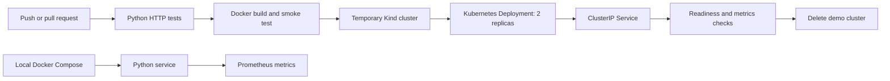

# DevOps Signal

A personal DevOps learning project: a small Python HTTP service, a hardened container, automated checks, an ephemeral Kubernetes deployment, and Prometheus metrics.

This is a demonstration project, not an employer system. It does not claim production traffic, business impact, or measured uptime. The Python standard-library HTTP server is deliberately simple and is not intended for an internet-facing production service.

## What this demonstrates

- HTTP liveness and readiness endpoints, JSON configuration output, and structured request logs.
- A non-root Docker image with a health check and read-only runtime compatibility.
- GitHub Actions that test HTTP behavior, build the image, and smoke-test the container.
- A second CI job that creates a temporary Kind cluster, deploys two replicas, waits for rollout, checks service responses, and deletes the cluster.
- Kubernetes resource limits, rolling updates, security contexts, and probes.
- A local Prometheus setup with example queries.

## Architecture



The pipeline deploys to its own temporary test cluster, not to AWS, Azure, or a production account. Images are loaded into Kind locally; this project does not publish container packages or require registry credentials.

## Run without Docker

Requires Python 3.12 or newer. No Python package installation is needed.

```sh
python -m unittest discover -s tests -v
python app.py
```

Open <http://localhost:8080/>. Stop the server with Ctrl+C.

| Route | Purpose |
| --- | --- |
| `/healthz` | Process liveness |
| `/readyz` | Readiness; the demo has no external dependencies |
| `/api/info` | Service name, configured environment, and version |
| `/metrics` | Prometheus counter and process age |

The readiness and liveness endpoints currently both return success while the process handles requests. In a real service, readiness would also evaluate necessary dependencies without turning transient dependency failures into liveness restart loops.

Optional environment variables: `PORT` (default `8080`), `APP_ENV` (default `local`), and `APP_VERSION` (default `dev`). The service only exposes those selected values, not the entire environment.

## Run the container

Requires Docker.

```sh
docker build -t devops-signal:local .
docker run --rm --read-only --cap-drop ALL --security-opt no-new-privileges -p 127.0.0.1:8080:8080 devops-signal:local
```

## Run with Prometheus

Requires Docker Compose v2.

```sh
docker compose up --build -d
```

Visit <http://localhost:8080/healthz>, then <http://localhost:9090/>. Try:

```promql
signal_requests_total
rate(signal_requests_total[5m])
signal_uptime_seconds
up{job="devops-signal"}
```

Requests include probes and metrics scrapes. The current `/metrics` response reports requests completed before that scrape. A restart resets the process-local counter. The demo does not have a persistent business-metrics store or production alerting.

```sh
docker compose down
```

## Deploy locally to Kubernetes

Requires Docker, Kind, and kubectl. These commands operate on a new local cluster named `signal`.

```sh
kind create cluster --name signal
docker build -t devops-signal:local .
kind load docker-image devops-signal:local --name signal
kubectl --context kind-signal apply -f k8s/
kubectl --context kind-signal rollout status deployment/devops-signal --timeout=120s
kubectl --context kind-signal get pods -l app=devops-signal
kubectl --context kind-signal port-forward service/devops-signal 8080:80
```

Open <http://localhost:8080/readyz>. Stop the port-forward with Ctrl+C. Remove only this demo cluster:

```sh
kind delete cluster --name signal
```

The Service is internal. There is no public load balancer, DNS, TLS, or cloud bill in this architecture. The scrape annotations are hints for a suitably configured cluster Prometheus; they do not install monitoring. Use Docker Compose for the included monitoring demo.

## CI/CD

The workflow is in [`.github/workflows/ci.yml`](.github/workflows/ci.yml). After pushing to GitHub, open the repository's **Actions** tab. Two jobs should appear:

1. `test-and-container`: unit/integration tests, Docker build, and a container smoke test.
2. `kubernetes-demo`: an automated deployment to a temporary local Kubernetes cluster and HTTP verification.

No deployment secrets are required. Repository permissions are limited to reading source. Hosted-runner availability and usage allowances are controlled by the GitHub account.

## Evidence and verification

See [docs/verification.md](docs/verification.md) for the actual verification status. A committed workflow is not proof of a successful workflow run. Add the first successful Actions run link after the repository is published; do not claim container or cluster tests passed until they do.

Suggested evidence to capture after running the project:

- A successful GitHub Actions run showing both jobs.
- `kubectl get pods` and `kubectl rollout status` output.
- Prometheus target health and the `signal_requests_total` graph.

## Engineering decisions and limitations

- **Small service, visible operations:** the app stays minimal so delivery, probes, security, and metrics are easy to inspect.
- **No cloud credentials:** CI uses an isolated temporary cluster to demonstrate deployment without exposing an account.
- **Two replicas:** demonstrates a Deployment and rolling-update settings, not a measured availability guarantee.
- **Resource requests are demo defaults:** tune them after measuring a real workload.
- **No production authentication or TLS:** keep the demo local; use a production HTTP server and proper ingress/security architecture before exposing a real service.
- **No software-supply-chain claim:** image signing, SBOMs, vulnerability scanning, and digest-pinned dependencies are future improvements, not completed features.

## Next increments

- Add measured container-size and startup-time results after running Docker.
- Add failure injection and a documented probe/recovery experiment.
- Add vulnerability scanning and dependency pinning with reviewed updates.
- Add an image registry and a separately approved persistent deployment environment.

## Author

Jaya Devi — personal portfolio project, developed with AI assistance.
