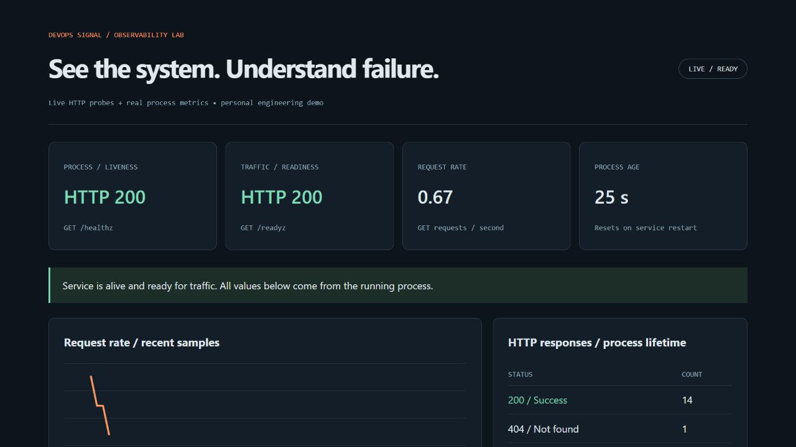
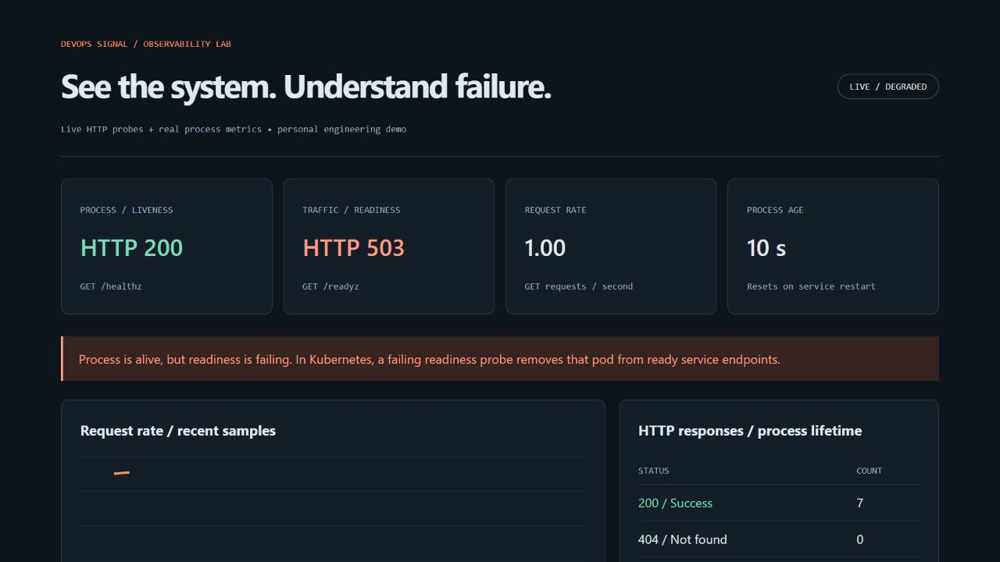
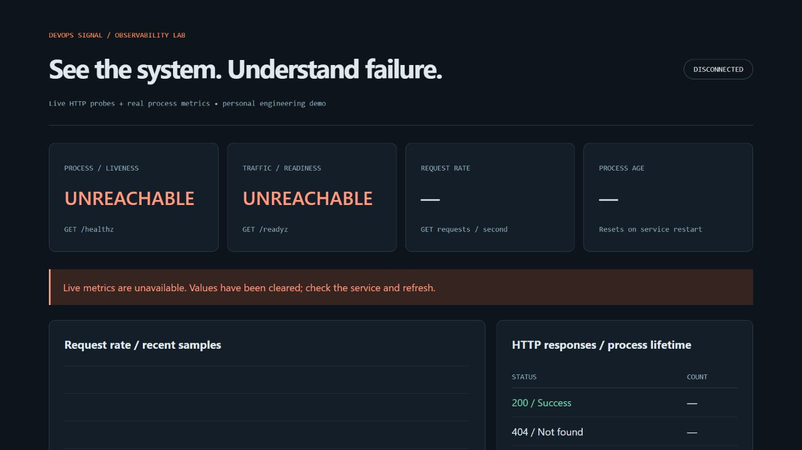

# Live monitoring dashboard

Run `python app.py` from the repository, then open <http://localhost:8080/dashboard>.
For containers, run `docker compose up --build -d` and use the same URL.

The dashboard polls the running service every three seconds. It shows HTTP liveness and readiness, request counts by status, process age, and a request-rate chart calculated from successive counter samples. Refresh makes a new measurement; it does not generate simulated metric values.

## Verified browser exercise — October 23, 2026

1. Start the service normally. Both probes return 200 and the dashboard reports LIVE / READY.
2. Stop it and restart with `APP_READY=false`. In PowerShell: `$env:APP_READY='false'; python app.py`. In a POSIX shell: `APP_READY=false python app.py`.
3. Observe liveness 200 and readiness 503, the degraded banner, and increasing 503 counts.
4. Stop the process while keeping the dashboard tab open. It reports DISCONNECTED and clears metric values and chart history.
5. Restart with readiness true (`$env:APP_READY='true'; python app.py` in PowerShell). The same tab reconnects and reports LIVE / READY.

### Healthy service

### Controlled readiness failure

### Service stopped

## Scope and tradeoffs

This lightweight dashboard consumes the app's Prometheus-format endpoint directly; it is not Grafana or a Prometheus query client. The existing Compose Prometheus service is separate. A real Prometheus scrape and Grafana integration have not been verified here.

Rates include dashboard polling, probes, scrapes and all other GET requests. They are not user-traffic rates. Counters reset on restart. History exists only in the current tab, holds up to 60 samples, and clears on disconnection or a detected process restart. A single service instance is observed, not an aggregated cluster. Probes are point-in-time observations, not an uptime SLO. There is no authentication: keep this learning service local.
